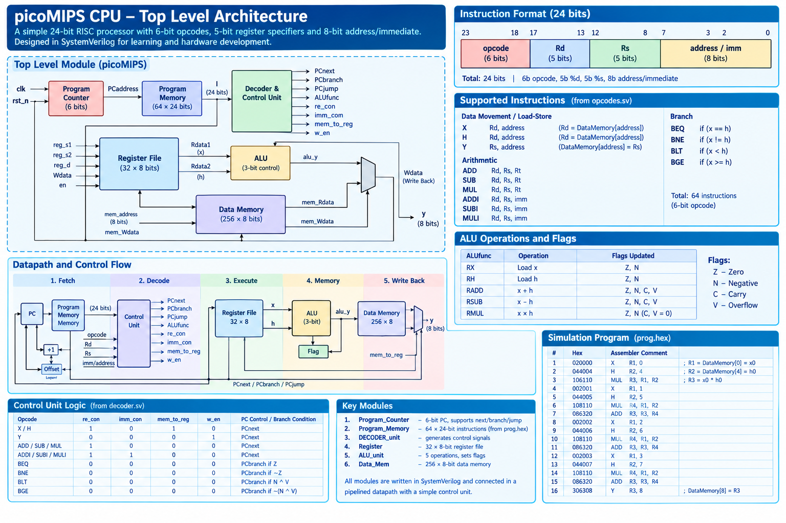

# PicoMIPS CPU — 8-bit Processor Design in SystemVerilog

## Project Overview

This is a personal RTL design project focused on the design and implementation of a small 8-bit integer processor using SystemVerilog. 
The project involves defining a custom instruction set and instruction format, and implementing key processor components, including the program counter, instruction decoder, register file, arithmetic logic unit (ALU), program memory and data memory.
The processor is designed to execute a four-tap Finite Impulse Response (FIR) filter program, performing integer multiplication and addition using input samples and filter coefficients stored in data memory. 
The project also involves developing a SystemVerilog testbench to simulate processor execution and verify the calculated FIR output against an independently computed reference result.
The project provides practical experience in RTL design, processor architecture, instruction decoding, signed arithmetic, memory interfacing and simulation-based functional verification.

## Tools: SystemVerilog, QuestaSim

## PicoMIPS Processor Architecture
The following diagram illustrates the overall architecture
of the PicoMIPS processor and its main functional components.



## Waveform 

## Transcript Result
```test
Time: 330 ns  Scope: picoMIPS_tb.dut.decoder File: C:/Users/lucas/OneDrive/Desktop/questasim_projects/questasim_bringup/picoMIPS design/DECODER_unit.sv Line: 81
Pass, y=24, expected_y=24
```

## Verification Summary
