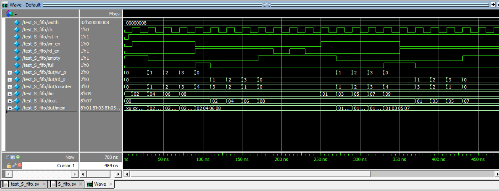

# Synchronous FIFO 

## Description
This design is for Synchronous FIFO and its Testbench with Reference Model and Assertions, including corner cases

## Waveform 

## Transcript Result
Time=0 rst_n=0 wr_en=0 rd_en=0 din=00 dout=00 empty=1 full=0
Time=5 rst_n=1 wr_en=0 rd_en=0 din=00 dout=00 empty=1 full=0
Time=10 rst_n=1 wr_en=1 rd_en=0 din=02 dout=00 empty=1 full=0   Reference model: 02
Time=30 rst_n=1 wr_en=1 rd_en=0 din=04 dout=00 empty=0 full=0   Reference model: 04
Time=50 rst_n=1 wr_en=1 rd_en=0 din=06 dout=00 empty=0 full=0   Reference model: 06
Time=70 rst_n=1 wr_en=1 rd_en=0 din=08 dout=00 empty=0 full=0   Reference model: 08
Time=90 rst_n=1 wr_en=0 rd_en=1 din=08 dout=00 empty=0 full=1
Time=110 rst_n=1 wr_en=0 rd_en=1 din=08 dout=02 empty=0 full=0   MATCH: actual=02, expected=02
Time=130 rst_n=1 wr_en=0 rd_en=1 din=08 dout=04 empty=0 full=0   MATCH: actual=04, expected=04
Time=150 rst_n=1 wr_en=0 rd_en=1 din=08 dout=06 empty=0 full=0   MATCH: actual=06, expected=06
Time=170 rst_n=1 wr_en=0 rd_en=1 din=08 dout=08 empty=1 full=0   MATCH: actual=08, expected=08
Time=190 rst_n=1 wr_en=0 rd_en=0 din=08 dout=08 empty=1 full=0
Time=210 rst_n=1 wr_en=0 rd_en=1 din=08 dout=08 empty=1 full=0
Time=230 rst_n=1 wr_en=0 rd_en=0 din=08 dout=08 empty=1 full=0
Time=250 rst_n=1 wr_en=1 rd_en=0 din=01 dout=08 empty=1 full=0   Reference model: 01
Time=270 rst_n=1 wr_en=1 rd_en=0 din=03 dout=08 empty=0 full=0   Reference model: 03
Time=290 rst_n=1 wr_en=1 rd_en=0 din=05 dout=08 empty=0 full=0   Reference model: 05
Time=310 rst_n=1 wr_en=1 rd_en=0 din=07 dout=08 empty=0 full=0   Reference model: 07
Time=330 rst_n=1 wr_en=1 rd_en=0 din=09 dout=08 empty=0 full=1
Time=350 rst_n=1 wr_en=0 rd_en=1 din=09 dout=08 empty=0 full=1
Time=370 rst_n=1 wr_en=0 rd_en=1 din=09 dout=01 empty=0 full=0   MATCH: actual=01, expected=01
Time=390 rst_n=1 wr_en=0 rd_en=1 din=09 dout=03 empty=0 full=0   MATCH: actual=03, expected=03
Time=410 rst_n=1 wr_en=0 rd_en=1 din=09 dout=05 empty=0 full=0   MATCH: actual=05, expected=05
Time=430 rst_n=1 wr_en=0 rd_en=1 din=09 dout=07 empty=1 full=0   MATCH: actual=07, expected=07
